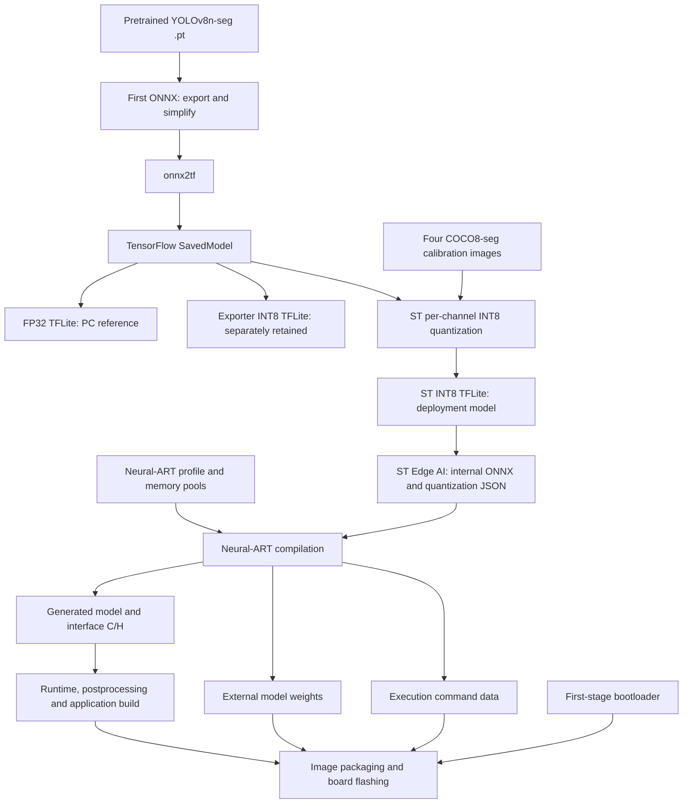

# STM32N6 MCU-Class Edge AI: NPU-Accelerated Real-Time Instance Segmentation

[繁體中文](README.md) | **English**

This is an **MCU-class edge AI system**. A pretrained YOLOv8n-seg model is exported, quantized to per-channel INT8 using ST tools, and compiled with Neural-ART for deployment on STM32N6. The on-chip NPU accelerates inference, working with the Cortex-M55 CPU to handle image processing and application control.

**After flashing, the system boots independently from external flash. Camera capture, model inference, segmentation postprocessing and LCD output all run on the board, without cloud services or a host computer performing inference.** The computer is used for model preparation, development and programming; a serial connection can optionally receive the board's results for logging.

**Technical focus:** Edge Computing · MCU-Class AI · Embedded AI · STM32N6570-DK · Cortex-M55 · Neural-ART NPU · YOLOv8n-seg · PyTorch · ONNX · onnx2tf · TensorFlow SavedModel · TFLite · Per-channel INT8 quantization · ST Model Zoo adaptation · C firmware · Camera / LCD · UART · Linker sections · External memory · Flash boot

The implementation covers the model workflow, Model Zoo code-generation corrections, detection/mask output mapping, NPU compilation, runtime and linker configuration, boot-image packaging and board deployment, together with structured UART output and person-region events.

## Project Goal and Deliverables

The model processes **256 × 256 RGB input** for **80-class instance segmentation**, and the board displays object classes, bounding boxes and individual masks. It publishes structured results over UART and detects people entering or leaving a defined region. Camera capture, inference, postprocessing and display run on the board.

The deliverables include application source, Model Zoo adaptation patches, model and deployment configurations, operational scripts, pinned versions, and records of correctness, performance, memory allocation, rebuilds and board operation. The eight-stage overview connects development with all A1–A5 tests; detailed verification and experiment results are collected at the end of this page.

## From Environment Setup to Board Acceptance: 8 Key Stages

These stages cover development, deployment and all A1–A5 tests. The detailed 17 development steps remain in the [work and code index](docs/WORK_IMPLEMENTATION_INDEX.md); measured results and test scope appear at the end of this page.

| Stage | Work | Code and records |
| --- | --- | --- |
| **1. Development platform, tools and upstream sources** | Prepare Ubuntu, STM32N6570-DK, camera, LCD and ST-LINK; distinguish power, debugging, serial communication and boot modes; pin development tools, both Python environments and upstream revisions. | [Tool versions](results/checkpoints/2026-09-09/source_versions.json) · [Environments](requirements/) · [Source map](docs/PUBLIC_SOURCE_MAP.md) |
| **2. Original model export and ST INT8 quantization** | Establish YOLOv8n-seg image/webcam baselines, then complete **PyTorch → first ONNX → SavedModel → ST per-channel INT8 TFLite**. Calibrate with four COCO8-seg images; check 256 × 256 input, 80 classes, tensor shapes and quantization parameters; compare original, floating-point and quantized models. | [PC baseline](docs/pc_baseline.md) · [Export log](results/checkpoints/2026-09-09/logs/03_export_seg.log) · [Quantization settings](configs/yolov8n_seg_int8_int8.yaml) · [Quantization log](results/checkpoints/2026-09-09/logs/04_st_quantization_seg.log) · [Model comparison](scripts/check_seg_models_pc.sh) |
| **3. Postprocessing adaptation and deployment checks** | Modify the Model Zoo generator to identify detection/prototype roles from shapes and map scales/zero points correctly; check 80 classes, 1,344 candidates, 32 coefficients and 64 × 64 prototypes while integrating upstream NMS and mask reconstruction. | [Modified generator](tools/model_zoo_overrides/instance_segmentation/tf/src/utils/gen_h_file.py) · [Header checker](scripts/check_n6_seg_header.py) |
| **4. Neural-ART compilation and NPU code generation** | Correct generation arguments and memory-pool handling, using UINT8/NHWC for camera input. Complete **ST INT8 TFLite → ST internal ONNX / quantization metadata → Neural-ART → model code, weights and execution command data**, preserving scheduling and memory reports. | [Generation adaptation](tools/model_zoo_overrides/common/benchmarking/common_benchmark.py) · [Generation script](scripts/n6_benchmark_local.sh) · [Neural-ART profile](configs/n6_neuralart_baseline.json) |
| **5. Runtime, memory placement and firmware flashing** | Align Cortex-M55 runtime headers/libraries, place model commands and postprocessing workspaces, correct image headers/alignment, and flash the bootloader, application, weights and command data for standalone boot. | [Build configuration](firmware/Application/STM32N6570-DK/STM32CubeIDE/.cproject) · [Linker script](firmware/Application/STM32N6570-DK/STM32CubeIDE/STM32N657xx.ld) · [Image patch](patches/instance_segmentation_signing_alignment.patch) · [Deployment script](scripts/deploy_n6_seg.sh) |
| **6. Camera, UART and person-region events** | Integrate capture, cache maintenance, inference, segmentation display, structured UART and person entry/exit events; add timing and failure handling, and retain the historical interrupt-driven UART experiment and restoration records. | [Main application](firmware/Application/STM32N6570-DK/Src/main.c) · [Camera pipeline](firmware/Application/STM32N6570-DK/Src/app_camerapipeline.c) · [Region events](firmware/Application/STM32N6570-DK/Inc/project_region_event.h) · [UART experiment](docs/publication_supplement_20261113/uart_it/source_snapshot/README.md) |
| **7. A2–A4: Correctness, performance and memory validation** | **A2:** four fixed inputs, three model-output sets and a 50-image regression; **A3:** camera-stage timing, repeated inference and execution-block bottleneck analysis; **A4:** reduce available NPU RAM and compare allocation, execution time and output equality. | [A2 correctness](docs/a2_validation_20260918/README.md) · [A3 performance](docs/a3_performance_20260918/README.md) · [A4 memory](docs/a4_memory_20260918/README.md) |
| **8. A1 and A5: Source rebuild and board acceptance** | **A1:** pin sources, patches and dependencies, verify restoration, clean-build in the existing environment and check flash readback; **A5:** three cold boots, controlled entry/exit, a 30-minute stability retest, simulated capture timeout and production firmware restoration, retaining failed-run records and the delivery index. | [A1 rebuild](docs/a1_reproducible_20260918/README.md) · [A5 acceptance](docs/a5_acceptance_20260919/README.md) · [Delivery index](docs/a5_acceptance_20260919/DELIVERY.md) |

## Model Conversion and Deployment Route

The first ONNX stage bridges the original PyTorch model to TensorFlow. The second is an internal compilation representation created by ST Edge AI after ST quantization. The exporter-produced INT8 file and the ST-quantized deployment file are preserved separately.

The recorded export toolchain uses Ultralytics 8.3.157, ONNX 1.16.1, opset 19, onnxslim 0.1.96, onnx2tf 1.26.3 and TensorFlow 2.18.0. The N6 build records identify ST Edge AI 4.0.1, STM32CubeIDE 2.2.0, GCC 14.3.1 and STM32CubeProgrammer 2.23.0.

## Tensor Interfaces and Postprocessing Adaptation

| Interface | Shape / representation | Integration work |
| --- | --- | --- |
| SavedModel input | `1×256×256×3`, FLOAT32 | Check RGB order, image size and floating-point preprocessing |
| ST TFLite input | `1×256×256×3`, INT8; scale approximately `1/255`, zero point `−128` | Verify pixel scaling and signed quantized representation |
| Generated N6 input | UINT8, NHWC | Configure the generated entry point for camera RGB888 input |
| Detection data | `1×116×1344` | Map 4 box coordinates + 80 class scores + 32 mask coefficients |
| Mask prototypes | `1×64×64×32` | Match prototype dimensions and quantization metadata to mask reconstruction |

The actual TFLite output list places mask prototypes before detection data. The corrected generator identifies the roles from tensor dimensions instead of assuming an output index. It checks INT8 types, the class/coefficient relationship, square prototypes and the upstream wrapper's size-order constraint before generating the header. The model's outputs remain in their original order.

The project adapts the postprocessing interface and integrates it with the application. Non-maximum suppression and mask-reconstruction kernels retain their ST upstream implementations.

## Engineering Corrections in the Deployment Path

| Integration issue | Project change | Source |
| --- | --- | --- |
| Detection and prototype outputs need the correct metadata | Infer tensor roles, map scales/zero points, validate dimensions, and check the generated header | [Generator](tools/model_zoo_overrides/instance_segmentation/tf/src/utils/gen_h_file.py) · [Header checks](scripts/check_n6_seg_header.py) |
| Local code generation must receive the intended configuration | Pass the Neural-ART profile, memory-pool and UINT8/INT8/NHWC settings with correct argument quoting | [Model Zoo generation code](tools/model_zoo_overrides/common/benchmarking/common_benchmark.py) |
| Generated code and runtime dependencies must match | Align the runtime headers and `NetworkRuntime1201_CM55_GCC.a`, including ModelZoo link settings | [Build configuration](firmware/Application/STM32N6570-DK/STM32CubeIDE/.cproject) · [Dependency record](patches/a1_source_20260918/dependencies.json) |
| Model commands and postprocessing buffers need defined placement | Configure `.flash_blob` for command data and `.psram_bss` for postprocessing workspace; inspect linker sections | [Build settings](firmware/Application/STM32N6570-DK/STM32CubeIDE/.cproject) · [Linker layout](firmware/Application/STM32N6570-DK/STM32CubeIDE/STM32N657xx.ld) |
| The generated application image needs the correct boot format | Correct the packaging options `-of 0x80000000` and `-align`, then deploy the resulting image | [Image alignment patch](patches/instance_segmentation_signing_alignment.patch) |

The local generation script produces model code and allocation reports. Runtime measurements come from the later board tests. The image-packaging change concerns header and alignment handling.

## On-Board Application and Communication

The production firmware uses a **bare-metal main loop with camera interrupt callbacks**. It combines continuous display capture, a snapshot for model input, buffer/cache maintenance, synchronous inference, ST segmentation postprocessing, region-state updates, UART output and display updates.

| Function | Implementation |
| --- | --- |
| Camera and inference | Coordinate capture completion and the model input buffer, run inference, and update boxes and masks on the LCD |
| Structured UART | Publish `FRAME`, `DET` and `END` records with a shared frame sequence, class, confidence, box coordinates and nonzero mask-pixel counts |
| Person-region events | Use the person box's bottom-center point; require three consecutive occupied frames for `ENTER` and five empty frames for `EXIT` |
| Region display | Draw the configured region and display occupancy, transition progress or invalid state |
| Failure handling | Check result validity and a 2,000 ms capture timeout; publish `INVALID` / `ERROR`, clear stale boxes and stop publishing detections until a manual reset |
| Timing instrumentation | Record capture, input preparation, inference, postprocessing, region logic, UART, display, cache maintenance, full cycles and logging overhead |

The UART `mask_pixels` field is a nonzero count from a 64 × 64 mask, not transmission of the full mask. The archived interrupt-driven UART experiment implements a ring queue, complete-line submission, reserved capacity for important messages and transfer statistics. Its deployment and restoration history is retained; the production A1 firmware uses blocking UART transmission, and no measured speedup is claimed for the historical experiment.

## Source, Rebuild and Delivery Map

| Entry point | Purpose |
| --- | --- |
| [main.c](firmware/Application/STM32N6570-DK/Src/main.c) | Main application flow, UART records, timing and failure handling |
| [app_camerapipeline.c](firmware/Application/STM32N6570-DK/Src/app_camerapipeline.c) | Camera capture and completion handling |
| [project_region_event.h](firmware/Application/STM32N6570-DK/Inc/project_region_event.h) | Person-region state transitions and invalid-state handling |
| [app_config.h](firmware/Application/STM32N6570-DK/Inc/app_config.h) | Application and postprocessing configuration |
| [Operational scripts](scripts/) and [configurations](configs/) | Model checks, PC comparisons, local generation and deployment entry points |
| [Model Zoo modifications](tools/model_zoo_overrides/) | Output mapping and local code-generation adaptations |
| [Pinned source patches](patches/a1_source_20260918/) | Upstream revisions, modifications, new files and binary dependencies |
| [Historical implementation archive](docs/publication_supplement_20261113/README.md) | UART experiments, detailed model analysis, generation logs and long-run serial logs |
| [Public source map](docs/PUBLIC_SOURCE_MAP.md) | Mapping from the original project to the published source copies |
| [Firmware delivery index](docs/a5_acceptance_20260919/DELIVERY.md) | Production image identifiers, component locations and flash addresses |

The `firmware/` directory contains the core application source copies. Building uses the pinned official application, SDK and dependencies described in [A1](docs/a1_reproducible_20260918/README.md). Full models, raw tensors, SDK/runtime binaries and flashable images are traced through their original locations and hashes; this repository is not a complete offline build bundle. The original temporary terminal programs have not all been preserved as a complete rerunnable test suite. A demonstration video is pending.

## Upstream Sources and Related Work

The pretrained model, drivers, runtime and core segmentation postprocessing retain their upstream origins. This project implements the conversion workflow, Model Zoo adaptations, deployment fixes, application integration, communication, region events and verification procedures.

- [ST Model Zoo](https://github.com/STMicroelectronics/stm32ai-modelzoo-services)
- [ST STM32N6 Instance Segmentation application](https://github.com/STMicroelectronics/STM32N6-GettingStarted-InstanceSegmentation)
- [Archived licenses](licenses/) and [source/modification map](docs/PUBLIC_SOURCE_MAP.md)

The follow-up [STM32N6 Voice-Guided Object Finder](https://github.com/fan-gu-hao/stm32n6-voice-object-finder) extends this development experience with audio capture, custom keyword spotting, INT8 deployment and FreeRTOS coordination of two models. Each project retains its own model versions and measured results.

## Verification and Experimental Results

| Stage | Work and results | Report |
| --- | --- | --- |
| **A1 — Source freeze and rebuild** | Restore and hash-check 100 modified/new source files and three binary dependencies; clean-build the production project, verify model command data and flash readback, and confirm operation after power cycling | [A1](docs/a1_reproducible_20260918/README.md) |
| **A2 — Model correctness and regression** | Four-image tensor/backend/postprocessing analysis, followed by 50 fixed images with 59 person annotations; N6 person precision **0.870**, recall **0.678**; matched PC INT8/N6 person boxes and masks have mean IoU **0.961 / 0.959** | [A2](docs/a2_validation_20260918/README.md) |
| **A3 — Pipeline and model profiling** | Analyze 1,000 full cycles per scene; camera processing including logs is **8.066–10.046 frames/s**. Check output equality across **35 inferences** and measure **58 execution blocks**; the two largest account for **56.71%** of profiled block time. General-mode mean inference over 30 runs, excluding warmup, is **48.6066 ms** | [A3](docs/a3_performance_20260918/README.md) |
| **A4 — Controlled memory allocation** | Reduce the npuRAM6 allocation limit from **448 to 320 KiB**; compiler-reported physical RAM pool usage falls by **162.5625 KiB**; both outputs for 50 images remain byte-for-byte identical to the original N6 baseline | [A4](docs/a4_memory_20260918/README.md) |
| **A5 — Board operation and failure handling** | Complete three cold boots, three controlled entry/exit trials, a fresh-boot 30-minute stability retest, simulated capture timeout and production firmware restoration | [A5](docs/a5_acceptance_20260919/README.md) |

### How to Read These Results

- **A1:** The clean build ran in the existing development environment. The isolated restoration directory was checked for matching sources and dependencies but was not built. Automated setup and a full build on a fresh computer remain unverified.
- **A2:** The regression set contains 25 images with people and 25 without. PC INT8 precision/recall is 0.872/0.695, compared with N6's 0.870/0.678. These fixed-threshold results are not standard COCO mAP. Fixed inputs use a central square crop, bilinear resizing and RGB; common PC postprocessing does not establish pixel equivalence with the camera path or the application C postprocessing.
- **A3:** Model execution and full camera-cycle timing have different boundaries. The latter includes capture, postprocessing, display and logging; the model timing includes hardware, hybrid and software execution blocks.
- **A4:** A/B mean inference times are 48.6079/48.5992 ms. The approximately 0.02% difference is not a demonstrated speedup. RAM figures describe compiler allocation, not whole-board peak runtime memory. Configuration B remains an experiment; the production camera firmware retains the original configuration. Byte equality is relative to the original N6 outputs, not PC INT8 outputs.
- **A5:** The first long run's sequence discontinuity and failed check are retained, with its cause still undetermined. The fresh-boot retest passed. The capture-timeout test uses software fault injection to check invalid-state indication, stale-box removal and stopped result publication; production firmware was restored afterward.
