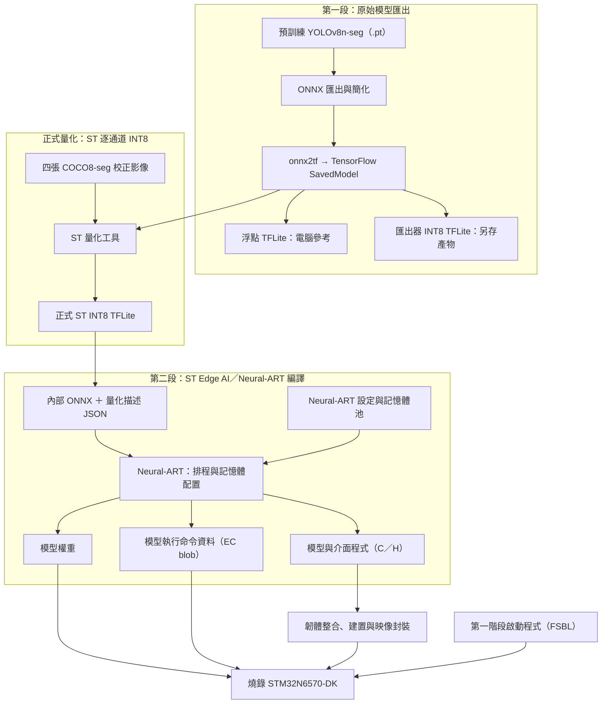

# STM32N6 即時實例分割｜模型轉換、INT8 量化與 NPU 部署

**繁體中文** | [English](README.en.md)

**技術關鍵字：** 嵌入式人工智慧（Embedded AI）・STM32N6570-DK・Arm Cortex-M55・神經網路處理器（NPU）・YOLOv8n-seg・ONNX・TensorFlow SavedModel・逐通道 INT8 量化・ST Edge AI／Neural-ART・C 韌體・攝影機擷取（DCMIPP）・後處理介面適配・記憶體配置・快取維護・串列通訊（UART）・獨立開機。

從預訓練 YOLOv8n-seg 出發，完成**模型匯出、ST 逐通道 INT8 量化、後處理輸出對應修正、NPU 產碼、執行期整合與實板部署**，在 STM32N6570-DK 上運作即時實例分割與人物區域事件。

本作品的主軸是把電腦上的模型接入微控制器的攝影機、記憶體、推論執行期與顯示系統；首頁以八個階段串起開發與 A1～A5 驗證，詳細量測結果放在頁面最後。

## 專案目標與完成條件

- 在板上處理 **256 × 256 RGB** 模型輸入，辨識 **80 類物件**，輸出類別、位置與每個物件的分割遮罩。
- 串接攝影機擷取、同步推論、分割後處理與 LCD 畫面更新，讓系統從外部快閃記憶體獨立啟動。
- 透過結構化串列資料傳回影格與物件資訊，並加入人物進入／離開指定區域的狀態判定。
- 完成模型正確性、完整處理週期、記憶體配置、來源重建與板端穩定性檢查。
- 保存操作方法、程式修改、工具版本、模型雜湊、實驗結果與失敗紀錄，形成可追溯的公開專案。

## 從環境建立到板端驗收：8 個重點階段

以下涵蓋開發、部署及 A1～A5 測試。細部的 17 項開發步驟保留在[完整工作與程式索引](docs/WORK_IMPLEMENTATION_INDEX.md)，各項量測數據與測試範圍列於本頁末段。

| 階段 | 工作內容 | 程式與紀錄 |
| --- | --- | --- |
| **1．開發平台、工具環境與官方來源** | 準備 Ubuntu、STM32N6570-DK、攝影機、LCD 與 ST-LINK；區分供電、除錯、串列及啟動模式，固定開發工具、兩套 Python 環境與官方來源版本。 | [工具版本](results/checkpoints/2026-09-09/source_versions.json)、[環境清單](requirements/)、[來源對照](docs/PUBLIC_SOURCE_MAP.md) |
| **2．原始模型匯出與 ST INT8 量化** | 建立 YOLOv8n-seg 圖片／攝影機基準，完成 **PyTorch → 第一段 ONNX → SavedModel → ST 逐通道 INT8 TFLite**。以四張 COCO8-seg 影像校正，核對 256 × 256 輸入、80 類、張量形狀及量化參數，比較原始、浮點與量化模型。 | [電腦基準](docs/pc_baseline.md)、[匯出日誌](results/checkpoints/2026-09-09/logs/03_export_seg.log)、[量化設定](configs/yolov8n_seg_int8_int8.yaml)、[量化日誌](results/checkpoints/2026-09-09/logs/04_st_quantization_seg.log)、[模型比較](scripts/check_seg_models_pc.sh) |
| **3．後處理介面適配與部署前檢查** | 修改模型工具庫產生器，依形狀辨識偵測／遮罩原型，正確配對尺度與零點；檢查 80 類、1344 候選、32 個係數及 64 × 64 原型，整合官方 NMS 與遮罩重建核心。 | [產生器修改](tools/model_zoo_overrides/instance_segmentation/tf/src/utils/gen_h_file.py)、[標頭檢查](scripts/check_n6_seg_header.py) |
| **4．Neural-ART 編譯與 NPU 模型產碼** | 修正產碼參數與記憶體池傳遞，以 UINT8／NHWC 銜接攝影機。完成 **ST INT8 TFLite → ST 內部 ONNX／量化描述 → Neural-ART → 模型程式、權重與執行命令資料**，保存排程與記憶體報告。 | [產碼流程修改](tools/model_zoo_overrides/common/benchmarking/common_benchmark.py)、[產碼腳本](scripts/n6_benchmark_local.sh)、[Neural-ART 設定](configs/n6_neuralart_baseline.json) |
| **5．執行期、記憶體配置與韌體燒錄** | 對齊 Cortex-M55 執行期與標頭，配置模型命令及後處理工作區；修正映像標頭／對齊，完成啟動程式、應用、權重與命令資料燒錄，以及獨立開機。 | [建置組態](firmware/Application/STM32N6570-DK/STM32CubeIDE/.cproject)、[連結腳本](firmware/Application/STM32N6570-DK/STM32CubeIDE/STM32N657xx.ld)、[映像修補](patches/instance_segmentation_signing_alignment.patch)、[部署腳本](scripts/deploy_n6_seg.sh) |
| **6．攝影機、串列通訊與人物區域事件** | 整合影像擷取、快取維護、推論、分割顯示、結構化 UART 與人物進出事件；加入分段計時及失效處理，保存串列中斷傳送的歷史實驗與還原紀錄。 | [主程式](firmware/Application/STM32N6570-DK/Src/main.c)、[攝影機流程](firmware/Application/STM32N6570-DK/Src/app_camerapipeline.c)、[區域事件](firmware/Application/STM32N6570-DK/Inc/project_region_event.h)、[串列實驗](docs/publication_supplement_20261113/uart_it/source_snapshot/README.md) |
| **7．A2～A4：模型正確性、效能與記憶體驗證** | **A2**：四張固定輸入、三組模型輸出與 50 張回歸比較；**A3**：攝影機分段計時、重複推論及逐區塊瓶頸分析；**A4**：縮減 NPU RAM 可分配容量，對照記憶體、時間與輸出一致性。 | [A2 正確性](docs/a2_validation_20260918/README.md)、[A3 效能](docs/a3_performance_20260918/README.md)、[A4 記憶體](docs/a4_memory_20260918/README.md) |
| **8．A1、A5：來源重建與板端運作驗收** | **A1**：固定來源、修補與相依檔，完成還原核對、既有環境乾淨重建及燒錄讀回；**A5**：三次冷啟動、人物進出、30 分鐘長測重測、模擬擷取逾時與正式韌體恢復，保存失敗紀錄及交付索引。 | [A1 重建](docs/a1_reproducible_20260918/README.md)、[A5 驗收](docs/a5_acceptance_20260919/README.md)、[交付索引](docs/a5_acceptance_20260919/DELIVERY.md) |

## 模型轉換與產碼路線

兩段 ONNX 各有用途：第一段把原始 PyTorch 模型帶入 TensorFlow 匯出流程；第二段是 ST 編譯器接收量化 TFLite 後產生的內部表示。**正式部署的是 ST 從 SavedModel 另行量化的模型。**

匯出流程記錄使用 Ultralytics 8.3.157、ONNX 1.16.1／算子集（opset）19、onnxslim 0.1.96、onnx2tf 1.26.3 與 TensorFlow 2.18.0。工具與環境來源分別保存在[套件清單](requirements/)及[工程流程](docs/engineering-workflow.md)。

## 模型介面與後處理適配

| 介面 | 形狀／表示 | 整合內容 |
| --- | --- | --- |
| 浮點模型輸入 | `1 × 256 × 256 × 3`，浮點 RGB | 核對輸入尺寸與前處理 |
| 正式 TFLite 輸入 | INT8；尺度約 `1/255`，零點 `−128` | 依模型中繼資料處理像素表示 |
| N6 產碼輸入 | UINT8，NHWC | 銜接攝影機 RGB888 像素 |
| 偵測資料 | `1 × 116 × 1344` | 4 個框座標＋80 個類別分數＋32 個遮罩係數 |
| 遮罩原型 | `1 × 64 × 64 × 32` | 與物件遮罩係數組合，重建各物件遮罩 |

實際 TFLite 的輸出列表是**遮罩原型在前、偵測資料在後**。本專案修改設定產生器，以形狀判斷輸出角色，將尺度、零點與後處理設定正確配對；模型本體輸出順序維持原樣。非極大值抑制（NMS）與遮罩重建核心沿用 ST 實作，專案完成其輸出介面修正、參數檢查與板端整合。

## 實際解決的工具與部署整合問題

| 整合問題 | 本專案修改 | 程式 |
| --- | --- | --- |
| 設定產生器對兩組輸出的角色假設不符實際模型 | 依張量形狀辨識角色，核對型別、類別數、遮罩係數與排序條件，產生正確參數 | [gen_h_file.py](tools/model_zoo_overrides/instance_segmentation/tf/src/utils/gen_h_file.py) |
| 本機產碼需要正確傳入配置與資料介面 | 補齊 Neural-ART 配置、記憶體池、UINT8／INT8 與通道排列參數，修正引號處理 | [common_benchmark.py](tools/model_zoo_overrides/common/benchmarking/common_benchmark.py) |
| 產碼、標頭與推論執行期必須相容 | 對齊 `NetworkRuntime1201_CM55_GCC.a`、標頭與正式 ModelZoo 建置組態 | [相依紀錄](patches/a1_source_20260918/dependencies.json)、[組態](firmware/Application/STM32N6570-DK/STM32CubeIDE/.cproject) |
| 模型命令與後處理暫存需放入指定區段 | 整合命令資料的 `.flash_blob` 與後處理工作區的 `.psram_bss`，核對連結布局 | [連結腳本](firmware/Application/STM32N6570-DK/STM32CubeIDE/STM32N657xx.ld)、[組態](firmware/Application/STM32N6570-DK/STM32CubeIDE/.cproject) |
| 應用映像需符合開機標頭與對齊要求 | 修正映像產生命令的 `-of 0x80000000` 與 `-align` 參數，完成封裝與實板部署 | [映像修補](patches/instance_segmentation_signing_alignment.patch) |

## 部署後的應用程式整合

正式韌體使用**單一主迴圈與攝影機中斷回呼**，完成影像擷取、同步推論、分割後處理、區域狀態、串列輸出與畫面更新。

| 功能 | 實作內容 | 程式 |
| --- | --- | --- |
| 攝影機與推論 | 顯示持續擷取、模型單次擷取、完成通知、輸入整理與快取維護 | [main.c](firmware/Application/STM32N6570-DK/Src/main.c)、[app_camerapipeline.c](firmware/Application/STM32N6570-DK/Src/app_camerapipeline.c) |
| 結構化串列 | 共用影格序號的 `FRAME／DET／END`，輸出類別、信心、框座標與 64 × 64 遮罩非零計數；傳回遮罩摘要，並以 `EVENT／ERROR／PROFILE` 回報事件、錯誤與效能 | [串列修改](patches/uart_inference_result.patch)、[main.c](firmware/Application/STM32N6570-DK/Src/main.c) |
| 人物區域事件 | 以人物框底邊中心判定區域；連續三幀有人觸發進入、五幀無人觸發離開，顯示區域狀態與確認進度 | [project_region_event.h](firmware/Application/STM32N6570-DK/Inc/project_region_event.h) |
| 失效處理 | 檢查物件資料；擷取等待超過 2000 毫秒或推論／後處理異常時回報失效、清除舊框、停止發布結果並等待人工重設 | [區域與錯誤處理](firmware/Application/STM32N6570-DK/Inc/project_region_event.h) |
| 分段量測 | 記錄擷取、推論、後處理、區域、串列、顯示及快取時間，處理暖機與日誌自身成本 | [量測修改](docs/a3_performance_20260918/instrumentation/a3_profile.patch) |

串列中斷傳送另有歷史實驗：環形佇列、完整列提交、重要訊息預留空間、中斷回呼與錯誤統計，相關[程式與部署／還原紀錄](docs/publication_supplement_20261113/uart_it/source_snapshot/README.md)均已保存。正式 A1 韌體使用阻塞傳送，這項實驗未作為已量測的加速成果。

## 程式、環境與重建入口

- [完整工作與程式索引](docs/WORK_IMPLEMENTATION_INDEX.md)：逐項對應開發工作、修改與結果。
- [工程流程與實作說明](docs/engineering-workflow.md)：模型轉換、介面與部署脈絡。
- [操作腳本](scripts/)與[模型／部署設定](configs/)：電腦推論、標頭檢查、本機產碼與部署入口。
- [核心韌體](firmware/)、[應用設定](firmware/Application/STM32N6570-DK/Inc/app_config.h)與[模型工具庫修改](tools/model_zoo_overrides/)：應用程式與工具適配來源。
- [來源對照](docs/PUBLIC_SOURCE_MAP.md)、[固定修補與相依紀錄](patches/a1_source_20260918/)及[交付索引](docs/a5_acceptance_20260919/DELIVERY.md)：來源版本、還原材料與燒錄產物位置。
- [歷史程式與補充資料](docs/publication_supplement_20261113/README.md)：串列中斷實驗、數值分析、產碼報告及原始日誌。

已使用的建置工具包含 STM32CubeIDE 2.2.0、GCC 14.3.1、ST Edge AI 4.0.1-20581 與 STM32CubeProgrammer 2.23.0。模型工具環境沿用前期偵測專案的 `env_export` 與 `env_mz`，詳細版本見[環境清單](requirements/)。`firmware/` 保存核心程式碼副本，編譯需搭配固定版本的官方專案、SDK 與相依檔案。

## 第三方來源與開發延續

- [ST Model Zoo](https://github.com/STMicroelectronics/stm32ai-modelzoo-services)
- [ST STM32N6 實例分割應用程式](https://github.com/STMicroelectronics/STM32N6-GettingStarted-InstanceSegmentation)
- [上游授權文件](licenses/)與[來源／修改對照](docs/PUBLIC_SOURCE_MAP.md)

預訓練模型、驅動、推論執行期與分割後處理核心保留上游來源；本專案完成模型流程、介面適配、工具與部署修補，以及通訊、區域事件與失效處理整合。第三方檔案保留原始著作權與授權資訊。

後續[雙模型語音找物作品](https://github.com/fan-gu-hao/stm32n6-voice-object-finder)延續本作品的視覺部署經驗，再加入收音、客製關鍵字模型與 FreeRTOS 雙模型協作；各作品保存各自模型與量測版本。**本作品示範影片待補。**

## 最後：測試、量測與驗收結果

| 階段 | 方法與主要結果 | 完整紀錄 |
| --- | --- | --- |
| **A1：來源與重建** | 固定官方基底與修補；還原核對 100 份來源及三份二進位相依，完成既有環境乾淨重建與燒錄讀回。 | [A1 報告](docs/a1_reproducible_20260918/README.md) |
| **A2：模型正確性** | 四張固定輸入的數值／後端／框／遮罩分析，再進行 50 張人物回歸。N6 人物精確率 **0.870**、召回率 **0.678**；電腦 INT8 為 **0.872／0.695**。電腦 INT8 與 N6 已配對人物的平均框／遮罩交並比（IoU）為 **0.961／0.959**。 | [A2 報告](docs/a2_validation_20260918/README.md) |
| **A3：效能與瓶頸** | 兩次暖機、30 次一般模式及三次逐區塊量測，核對 35 次輸出。一般推論平均 **48.6066 毫秒**；58 個量測區塊的前兩項占 **56.71%**。無人／一人場景各量測 1000 個完整週期，含日誌的處理速率約 **8.066～10.046 幀／秒**。 | [A3 報告](docs/a3_performance_20260918/README.md) |
| **A4：記憶體配置** | 將 npuRAM6 可分配容量 **448 → 320 KiB**，編譯器回報的實體 RAM 池已用量減少 **162.5625 KiB**；50 張板端輸出與原 N6 基準逐位元組一致。 | [A4 報告](docs/a4_memory_20260918/README.md) |
| **A5：板端驗收** | 三次冷啟動、三次人物進出、30 分鐘穩定性重測與模擬擷取逾時檢查通過；確認失效提示、清除舊框與停止發布結果，最後恢復正式韌體。 | [A5 報告](docs/a5_acceptance_20260919/README.md) |

### 結果的量測範圍

- **A1 重建範圍：** 乾淨重建在既有環境完成；隔離目錄完成來源與相依檔還原核對，未在該目錄重新編譯。全新電腦的自動環境安裝與完整重建尚未驗證。
- **A2 資料與後處理：** 50 張包含有人、無人各 25 張，共 59 個人物標註，屬固定部署回歸集，並非標準 COCO mAP。採中央裁切、雙線性縮放至 256 × 256、RGB 與共同電腦後處理；攝影機 DCMIPP 像素及板端 C 後處理等價性未由此測試直接驗證。
- **數值一致性：** 電腦 INT8 與 N6 原始輸出存在差異；A4 的逐位元組一致是 B 配置與原 N6 基準之間的比較。
- **A3 時間範圍：** 模型執行包含硬體、混合與軟體區塊；攝影機完整週期另計擷取、後處理、顯示與日誌，兩者分開呈現。
- **A4 配置與時間：** RAM 數字來自編譯器配置報告。A／B 平均推論 **48.6079／48.5992 毫秒**，差異約 **0.02%**，未據此宣稱明確加速；正式攝影機韌體維持原配置，B 保留為實驗版本。
- **A5 長測與故障：** 首次長測的序號不連續與未通過判定仍保留，根因未確定；後續從新開機同步的 30 分鐘重測通過。逾時驗收使用軟體故障注入，測試後已恢復正式 A1 韌體。
- **公開重現材料：** 部分臨時終端測試尚未保存為成套操作腳本；完整模型、原始張量、SDK、函式庫與可燒錄映像依來源及雜湊索引準備，儲存庫尚未提供完整離線建置套件。
